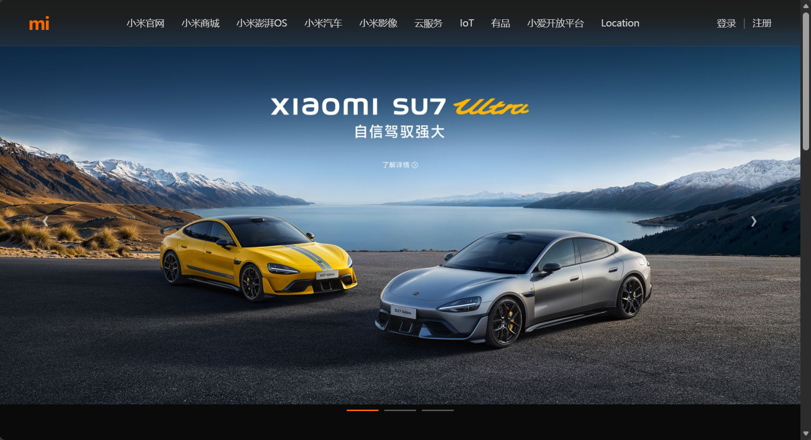

# 小米官网首屏复刻

照着小米官网首屏抄了一遍，目的是练布局。

## 在线预览

https://chaojikun666.github.io/p02-xiaomi/

## 复刻了什么

- 固定顶部导航 + 毛玻璃背景（`position: fixed` + `backdrop-filter`）
- 满屏首屏大图（`height: 100vh` + ``）
- 左右切换箭头、底部进度条（`position: absolute` 定位）
- 商品卡片区，一行四列（CSS Grid）
- 文字压图的三层结构（`relative` 父 + `absolute` 背景 + `relative` 文字）

## 技术点

| 招式 | 用在哪 |
| --- | --- |
| `position: fixed` | 导航栏钉在顶部 |
| `backdrop-filter: blur()` | 导航毛玻璃 |
| `position: absolute` + `inset: 0` | 背景层铺满 |
| `transform: translateY(-50%)` | 箭头垂直居中 |
| Flex | 导航左右分栏、垂直居中 |
| Grid | 商品卡片区 |

## 和原站不一样的地方

- 原站用 Tailwind CSS + 自研尺寸 token，这里用传统 CSS
- 原站的图片是"纯背景 + HTML 文字层"；我下载到的图文字已烧入，所以删掉了文字层
- 没做轮播的 JS 逻辑，只做静态样式

## 踩过的坑

1. **`background-size: cover` 会把宽图两侧裁掉** —— 两条车正好在两边，被切了。改用 ``。
2. **从官网截图裁图，文字会一起裁进去** —— 应该去 DOM 里找原始图片地址。
3. **官网是 Swiper 轮播** —— 复制 DOM 时只能拿到当前那一屏的图。
4. **CDN 返回的 webp 被存成了 .jpg** —— 扩展名和真实格式不符，浏览器能显示但很乱。
5. **`index.html` 建成了文件夹** —— Windows 隐藏扩展名 + 新建菜单默认选文件夹。

## 截图

